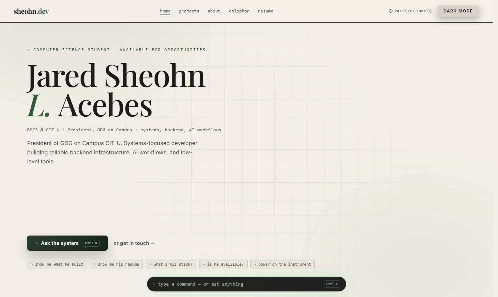

<a href="https://sheohn.dev">
  <picture>
    <source media="(prefers-color-scheme: dark)" srcset="docs/assets/readme-hero-dark.png" />
    
  </picture>
</a>

# hey, i'm jared

I'm a CS student at CIT-U in Cebu, and I lead GDG on Campus there. I like building systems: backend infrastructure, AI workflows, and low-level tools that usually go a little deeper than they strictly need to.

This repo is my little corner of the internet. The best way to get to know me is just to visit **[sheohn.dev](https://sheohn.dev)**.

## a few things i've built

- **[Crucible](https://sheohn.dev/projects/crucible)**: a multi-agent pipeline that fuses two RPG sprites into a brand-new one.
- **[Lexicon](https://sheohn.dev/projects/lexicon)**: my own programming language, with a Rust interpreter and a WebAssembly playground.
- **[AniMo](https://sheohn.dev/projects/animo)**: an AI matching engine that pairs farm supply with demand to cut food waste. Built for the GDG Solutions Challenge 2025.

## say hi to the terminal

There's a little terminal docked at the bottom of the site (<kbd>Ctrl</kbd> + <kbd>K</kbd>). It's a real shell (try `help`), and it doubles as an AI agent that knows about me. Ask it about my work and it answers, and it might also drive the page for you: scroll to the right section, open a case study, or turn the lights off.

Under the hood it's Gemini through the Vercel AI SDK. It pulls from a small memory of facts about me, and its tool calls come back to the page as UI moves.

Prefer your own tooling? There's a read-only MCP server too, so Claude Code, Cursor and friends can ask about me directly: `claude mcp add --transport http sheohn https://www.sheohn.dev/mcp`.

## find me

[LinkedIn](https://www.linkedin.com/in/jared-sheohn-acebes-316aab297) · [Resume](https://aleda1faaxt35aum.public.blob.vercel-storage.com/Acebes_Jared_Resume.pdf) · or just ask the terminal.

---

Built with Astro and Svelte. If you want to run it or poke at the internals, see [docs/DEVELOPMENT.md](docs/DEVELOPMENT.md).
